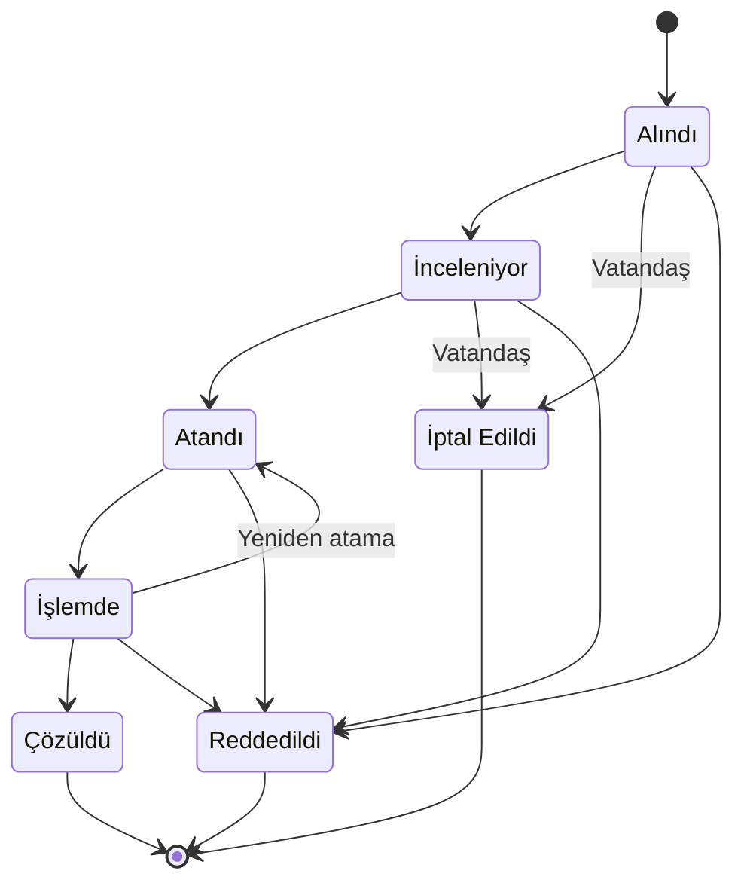
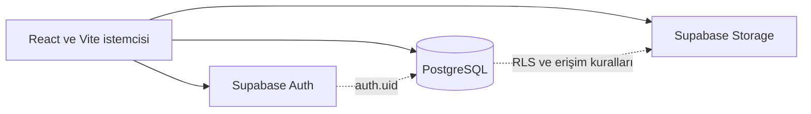
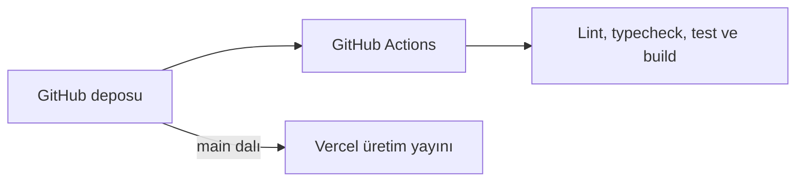

<div align="center">


# KırsalİZ

**Konum tabanlı kırsal hizmet talep ve karar destek platformu.**

KırsalİZ, Elazığ'daki köylerde yol, su ve altyapı gibi hizmet taleplerinin vatandaş tarafından konumuyla bildirilmesi, ilgili birime yönlendirilmesi ve çözüme kadar takip edilmesi amacıyla geliştirilmiş bir web uygulamasıdır.

### [Canlı uygulama: kirsaliz.vercel.app](https://kirsaliz.vercel.app/)

[](https://github.com/selanurayaz/kirsaliz/actions/workflows/ci.yml)

</div>

> **Not:** KırsalİZ bir staj/portföy ve pilot çalışmadır. Gerçek bir kamu kurumunun resmî sistemi değildir ve herhangi bir kurumla entegre çalışmaz.

## Proje Hakkında

Kırsal bölgelerde yaşayan vatandaşlar yol, su ve altyapı sorunlarını doğru birime ulaştırmakta zorlanabilir. Talebin ne zaman ve hangi aşamada ele alındığı çoğu zaman görülemez. Birim yetkilileri ile saha personelinin de talepleri ortak bir kayıt üzerinden yürütebileceği, takip edilebilir bir iş akışına ihtiyacı vardır.

KırsalİZ bu üç ihtiyacı tek uygulamada karşılar:

- Vatandaş, ilçe ve gerçek köy seçerek talebini kategori, aciliyet, açıklama, isteğe bağlı cihaz konumu ve fotoğrafla bildirir.
- Talep, kategorisine bağlı birime düşer; birim yetkilisi talebi inceler, saha personeline atar, sonucu kaydeder.
- Her durum geçişi tarih ve notuyla durum geçmişine yazılır; vatandaş talebini takip koduyla ve geçmişiyle izler.

## Temel Özellikler

### Vatandaş

- Kayıt, giriş ve e-posta doğrulama
- Kişisel profil (ad soyad, telefon, köy) ve şifre yönetimi
- İlçe ve gerçek köy seçimi
- Kategori, aciliyet, açıklama, cihaz konumu ve fotoğrafla (en fazla 3 adet, her biri en fazla 5 MB; JPEG, PNG, WebP) talep oluşturma
- Talepleri takip kodu, durum ve geçmiş bilgileriyle izleme
- İnceleme aşamasına gelmemiş talebi iptal etme

### Kurum personeli (birim yetkilisi ve saha personeli)

- Birime gelen veya kendisine atanan talepleri görüntüleme; arama, durum, aciliyet ve (yönetici için) birim filtreleri
- Talebi incelemeye alma, saha personeline atama ve gerekçesiyle reddetme (birim yetkilisi ve yönetici)
- Atanan çalışmayı başlatma ve çözüm notuyla çözme (atanan saha personeli)
- Durum geçmişini görüntüleme

Hangi işlemin hangi rol tarafından yapılabildiği veritabanında kontrol edilir (bkz. [Rol ve Yetki Modeli](#rol-ve-yetki-modeli)).

### Yönetici

- Tüm kurum taleplerini izleme
- Kullanıcı rollerini, birimlerini ve hesap durumlarını (aktif/pasif) yönetme
- Yetki değişikliklerini, denetim kaydı tutan yönetim akışıyla yapma

## Rol ve Yetki Modeli

| Rol | Kod | Erişebildiği temel alan |
|---|---|---|
| Vatandaş | `citizen` | Panel, yeni talep, kendi talepleri ve profil |
| Birim yetkilisi | `department_officer` | Kendi birimine ait talepler: inceleme, atama, reddetme |
| Saha personeli | `field_personnel` | Kendisine atanan talepler: çalışmayı başlatma, çözme |
| Yönetici | `admin` | Tüm talepleri izleme ve yönetme (inceleme, atama, reddetme); kullanıcı/rol/birim yönetimi |

Yetkilendirme iki katmanlıdır ve katmanların görevi farklıdır:

- **Route guard (istemci):** `ProtectedRoute`, `RoleRoute` ve `GuestOnlyRoute` kullanıcıyı doğru sayfaya yönlendirir ve yetkisiz sayfaları gizler. Bu bir kullanım kolaylığıdır, güvenlik sınırı değildir.
- **RLS ve RPC (veritabanı):** Verinin gerçekten kim tarafından okunup yazılabileceği Supabase Row Level Security politikaları, tetikleyiciler ve dar kapsamlı RPC fonksiyonlarıyla belirlenir. İstemciden gelen rol bilgisine güvenilmez; yetki `auth.uid()` ve `profiles` tablosundan sunucuda çözülür.

## Talep İş Akışı

Durumlar `service_request_status` enum'undan, geçiş kuralları `004_staff_workflow.sql` içindeki tetikleyiciden alınmıştır. Şema ana yolu ve yan durumları gösterir; `Alındı` durumundan doğrudan `Atandı` durumuna geçiş gibi kısa yollar için tetikleyiciye bakınız.



- `İptal Edildi` yalnızca talep sahibi tarafından ve yalnızca `Alındı` / `İnceleniyor` aşamalarında verilebilir.
- `Reddedildi` ve `Çözüldü` için açıklama notu zorunludur (en az 10 karakter).
- `Çözüldü`, `Reddedildi` ve `İptal Edildi` durumlarından başka bir duruma geçiş tanımlı değildir.

## Teknolojiler

| Alan | Teknoloji |
|---|---|
| Arayüz | React 19 |
| Dil | TypeScript |
| Derleme ve geliştirme sunucusu | Vite |
| Yönlendirme | React Router 7 |
| Stil | Tailwind CSS 4 |
| Kimlik doğrulama | Supabase Auth |
| Veritabanı | PostgreSQL (Supabase) |
| Dosya depolama | Supabase Storage (özel bucket) |
| Veri erişim denetimi | Row Level Security, security-definer RPC fonksiyonları |
| Test | Vitest, Testing Library |
| Kod kalitesi | ESLint, `tsc` tür denetimi |
| CI | GitHub Actions |
| Yayın | Vercel |

## Mimari



Geliştirme ve yayın tarafı ayrıdır:



## Proje Yapısı

```text
.
├── .github/workflows/     # CI iş akışı (ci.yml)
├── public/                # Statik dosyalar (favicon.svg)
├── src/
│   ├── components/        # Arayüz bileşenleri (geo/ ve profile/ alt klasörleriyle)
│   ├── context/           # Oturum (Auth) context'i
│   ├── hooks/             # Özel React hook'ları
│   ├── layouts/           # Ana ve kimlik doğrulama yerleşimleri
│   ├── lib/               # Supabase istemcisi, veri erişimi, doğrulama, yardımcılar
│   ├── pages/             # Sayfa bileşenleri
│   ├── routes/            # Router, route guard'ları, lazy sayfalar
│   └── types/             # Veritabanı ve gezinme tipleri
├── supabase/
│   ├── migrations/        # Sıralı SQL migration dosyaları (001–006)
│   └── seed/              # İsteğe bağlı demo verisi
└── vercel.json            # SPA rewrite kuralı
```

## Yerel Kurulum

Gereksinimler: Node.js (CI, Node 22 ile çalışır) ve bir Supabase projesi.

```bash
# 1. Repoyu klonlayın
git clone https://github.com/selanurayaz/kirsaliz.git

# 2. Proje klasörüne geçin
cd kirsaliz

# 3. Bağımlılıkları yükleyin
npm install

# 4. Ortam dosyasını oluşturun
cp .env.example .env.local        # Windows PowerShell: Copy-Item .env.example .env.local

# 5. .env.local içindeki değişkenleri doldurun (aşağıya bakın)

# 6. Geliştirme sunucusunu başlatın
npm run dev
```

`.env.local` içinde yalnızca şu iki değişken gerekir (değerleri Supabase → Project Settings → API sayfasından alın):

```env
VITE_SUPABASE_URL=
VITE_SUPABASE_PUBLISHABLE_KEY=
```

- Supabase `service_role` anahtarı istemciye **kesinlikle** eklenmemelidir; bu uygulama yalnızca yayınlanabilir (publishable) anahtarı kullanır.
- `.env.local` dosyası `.gitignore` ile izleme dışıdır; depoya gönderilmemelidir.
- Yerel geliştirme için Supabase → Authentication → URL Configuration bölümünde `http://localhost:5173` yönlendirmesinin tanımlı olması gerekir.

## Veritabanı Kurulumu

Migration dosyaları [supabase/migrations](supabase/migrations) altındadır; Supabase SQL Editor'da aşağıdaki sırayla çalıştırılmalıdır. Dosyalar tekrar çalıştırılabilir olacak şekilde yazılmıştır.

| Sıra | Dosya | Amaç |
|---|---|---|
| 1 | `001_profiles.sql` | Rol enum'unu ve `auth.users` ile bağlı `profiles` tablosunu, yetkili alanları koruyan tetikleyiciyi ve RLS'i oluşturur. |
| 2 | `002_reference_data.sql` | İlçe, köy, birim ve talep kategorisi tablolarını ve `is_admin()` fonksiyonunu ekler. |
| 3 | `003_service_requests.sql` | Talepler, durum geçmişi ve fotoğraf ekleri tablolarını, RLS politikalarını ve özel Storage bucket'ını oluşturur. |
| 4 | `004_staff_workflow.sql` | Durum geçiş kurallarını, kurum iş akışı RPC'lerini ve yönetici kullanıcı yönetimiyle erişim denetim kaydını ekler. |
| 5 | `005_real_elazig_villages.sql` | Elazığ'ın 547 gerçek köyünü yükler ve kullanılmayan demo köyleri temizler. |
| 6 | `006_user_profile.sql` | Kullanıcının kendi profilini ve köyünü güvenle güncelleyebilmesi için `update_my_profile()` RPC'sini ekler. |

**İlk yönetici:** Hiçbir migration kimseyi otomatik yönetici yapmaz. Kayıt olduktan sonra, SQL Editor'da tek seferlik olarak (e-posta adresini kendinizinkiyle değiştirin):

```sql
update public.profiles
set role = 'admin'
where id = (select id from auth.users where email = 'YONETICI_EPOSTASI');
```

SQL Editor'dan yapılan bu güncelleme, `001` içindeki koruma tetikleyicisinin yalnızca `anon`/`authenticated` istemcilerini engellemesi sayesinde çalışır. Sonraki rol ve birim değişiklikleri uygulamadaki Kullanıcı Yönetimi sayfasından yapılır.

**Demo seed (isteğe bağlı):** [supabase/seed/001_demo_villages.sql](supabase/seed/001_demo_villages.sql) sentetik "Örnek Köy NN" kayıtları (uydurma nüfus ve koordinatla, `is_demo = true`) ekler ve yalnızca `002` migration'ını gerektirir. Çalıştırılması zorunlu değildir.

- **005'ten önce çalıştırılırsa:** `005`, hiçbir talep veya profil tarafından kullanılmayan demo köyleri siler; kullanılanlar `is_demo = true` olarak kalır.
- **005'ten sonra çalıştırılırsa:** Demo köyler yeniden eklenir (aynı ada sahip kayıt varsa atlanır). Yeni talep formu `is_demo = true` köyleri listelemez; yani kayıtlar veritabanında bulunur ama kullanıcıya seçenek olarak sunulmaz.
- Demo kayıtları temizlemek için seed dosyasının başındaki `delete from public.villages where is_demo;` ifadesi kullanılabilir. Talepler köyleri `on delete restrict` ile referans ettiği için, bir talep tarafından kullanılan köy silinemez.

## Kullanılabilir Komutlar

| Komut | Açıklama |
|---|---|
| `npm run dev` | Geliştirme sunucusunu başlatır |
| `npm run lint` | ESLint çalıştırır |
| `npm run typecheck` | `tsc` ile tür denetimi yapar |
| `npm run test` | Vitest'i çalıştırır (etkileşimli terminalde watch modunda kalabilir) |
| `npm run test:run` | Testleri tek seferlik çalıştırır (CI bunu kullanır) |
| `npm run test:watch` | Testleri watch modunda çalıştırır |
| `npm run test:coverage` | Testleri tek seferlik, kapsam raporuyla çalıştırır |
| `npm run build` | Tür denetimi + production derlemesi (`dist/`) |
| `npm run preview` | Production derlemesini yerelde önizler |
| `npm run check` | `lint`, `typecheck` ve `test:run` komutlarını sırayla çalıştırır |

Tek seferlik test için `npm run test:run` (veya `npm run test -- --run`) kullanın.

## Test ve Kalite

`npm run lint`, `npm run typecheck`, `npm run test:run` ve `npm run build` komutları yerelde çalıştırılmış ve geçmiştir (son doğrulamada 23 test dosyası, 202 test). Aynı dört adım her push ve `main` hedefli pull request için GitHub Actions'ta da çalışır; CI'da Supabase için sahte yer tutucu değerler kullanılır.

Testler şu alanları kapsar:

- Saf yardımcı fonksiyonlar (biçimlendirme, sabitler, gezinme)
- Form ve bileşen davranışları (talep doğrulama, görsel yükleme, onay penceresi, kartlar, rozetler, geri bildirim bileşenleri)
- Route guard'lar ve rol erişimleri
- Profil ve parola işlemleri
- Hata eşleme (kullanıcıya gösterilebilir iş kuralı hataları ve genel hata mesajları)
- Migration ve veri kontrolleri (gerçek köy migration'ının içeriği, referans veri)
- Ana sayfa ve layout regresyon kontrolleri

Testler uygulama kodunu çalıştırır; gerçek bir Supabase örneğine karşı uçtan uca (E2E) test içermez.

## Güvenlik Yaklaşımı

- Tüm tablolarda **Row Level Security** etkindir; kullanıcı yalnızca politikaların izin verdiği satırlara erişir.
- Kullanıcı izolasyonu `auth.uid()` temellidir; vatandaş kendi taleplerini görür, personel yalnızca birimine veya kendisine atanan talepleri görür.
- Durum ve atama değişiklikleri doğrudan `UPDATE` ile değil, `auth.uid()` ile yetkiyi sunucuda çözen, dar kapsamlı **security-definer RPC** fonksiyonlarıyla yapılır. Bu fonksiyonlarda `search_path` boştur ve `anon` için çalıştırma yetkisi kapatılmıştır.
- Durum geçiş matrisi ve değişmez alanlar (takip kodu, talep sahibi, birim vb.) veritabanı tetikleyicileriyle korunur.
- İstemcide `service_role` anahtarı bulunmaz; yalnızca yayınlanabilir anahtar kullanılır.
- `role`, `is_active` ve birim değişiklikleri yalnızca yönetici RPC'siyle yapılır ve denetim kaydına yazılır; kullanıcı kendi rolünü değiştiremez.
- Fotoğraflar özel bir Storage bucket'ında tutulur. Yükleme yalnızca kendi klasörüne ve kendi talebine yapılabilir; okuma, talep sahibi ile talebe erişimi olan kullanıcılarla sınırlıdır.
- `.env.local` dosyası Git tarafından izlenmez; depoda yalnızca yer tutucu içeren `.env.example` bulunur.

Bu önlemler pilot kapsamında uygulanmıştır; bağımsız bir güvenlik denetimi yapıldığı anlamına gelmez.

## Veri Kaynağı

**İlçe ve köy adları** Türkiye İçişleri Bakanlığı'nın [Mülki İdare Bölümleri Envanteri](https://www.e-icisleri.gov.tr/Anasayfa/MulkiIdariBolumleri.aspx)'ne dayanır. Resmî sayfa program aracılığıyla toplu olarak okunamadığından, aynı envanterden derlenen [sabrigunes/turkey-administrative-units-dataset](https://github.com/sabrigunes/turkey-administrative-units-dataset) açık veri seti (CC0 1.0) kullanılmıştır. Veri setinin referans tarihi **Ekim 2025**'tir (depo kaydı `359332c`, 2025-10-06). Veri gerçek zamanlı değildir; bu tarihteki durumu yansıtır ve resmî bir kurum entegrasyonu değildir.

- Yalnızca **Elazığ** kayıtları içe aktarılmıştır ve yalnızca "köy" sınıfındaki kayıtlar alınmıştır; mahalle, belde ve bağlı yerleşimler kapsam dışıdır.
- Kaynakta adlar büyük harflidir; Türkçe yazım kurallarına göre baş harfi büyük biçime çevrilmiştir. Merkez ilçe `Merkez` olarak tutulur.
- **Nüfus ve koordinat bilgisi bilinçli olarak boş (NULL) bırakılmıştır**; seçilen kaynakta bulunmadığı için uydurulmamıştır. Talebin kesin konumu, vatandaşın tarayıcısından alınan GPS bilgisiyle ayrıca sağlanır.
- İçe aktarma tarihi: 2026-11-03 ([005_real_elazig_villages.sql](supabase/migrations/005_real_elazig_villages.sql)).

| İlçe | Köy sayısı |
|---|---:|
| Ağın | 16 |
| Alacakaya | 10 |
| Arıcak | 10 |
| Baskil | 60 |
| Karakoçan | 88 |
| Keban | 30 |
| Kovancılar | 76 |
| Maden | 38 |
| Merkez | 132 |
| Palu | 37 |
| Sivrice | 50 |
| **Toplam** | **547** |

**Gerçek ve demo veri ayrımı:** `supabase/seed/001_demo_villages.sql` sentetik "Örnek Köy NN" kayıtları üretir ve yalnızca geliştirme/test içindir. Üretim referans verisi, `005` numaralı migration ile gelen gerçek köylerdir (`is_demo = false`). Bir talep tarafından kullanılan demo köyler tarihsel bütünlük için silinmez, ancak arayüz `is_demo = true` köyleri yeni talep formunda listelemez.

**Harita verisi ve atıf:** Ana sayfadaki Elazığ il sınırı, OpenStreetMap (ilişki 223443) verisinden sadeleştirilmiş yerel bir SVG yoludur. Veri © OpenStreetMap katkıcıları, [ODbL 1.0](https://www.openstreetmap.org/copyright). Fırat–Keban güzergâhı ve nehir animasyonu stilize arayüz öğeleridir; idari veya navigasyon haritası değildir. Çalışma zamanında harita servisine istek yapılmaz. Bkz. [src/components/geo/elazig-geo.ts](src/components/geo/elazig-geo.ts).

## Deployment

Uygulama **Vercel** üzerinde, GitHub deposundan (`selanurayaz/kirsaliz`) yayımlanır: [kirsaliz.vercel.app](https://kirsaliz.vercel.app/). `main` dalına yapılan her birleştirme otomatik olarak üretime dağıtılır; pull request'ler önizleme dağıtımı alabilir. Dağıtımı Vercel'in GitHub entegrasyonu yapar; GitHub Actions yalnızca lint, tür denetimi, test ve derleme çalıştırır.

| Ayar | Değer |
|---|---|
| Framework Preset | Vite |
| Install Command | `npm install` |
| Build Command | `npm run build` |
| Output Directory | `dist` |

- [vercel.json](vercel.json), React Router'ın istemci tarafı rotaları (ör. `/giris`, `/taleplerim/:id`, `/kurum`) doğrudan açıldığında veya sayfa yenilendiğinde `index.html` döndürür. Vercel önce gerçek dosyaları sunduğu için `/assets/` altındaki dosyalar olduğu gibi yüklenir.
- **Ortam değişkenleri** (Vercel → Project Settings → Environment Variables): `VITE_SUPABASE_URL` ve `VITE_SUPABASE_PUBLISHABLE_KEY` üretim ortamında tanımlanmalıdır. Bu değerler yalnızca Vercel panelinde girilir, depoya eklenmez. `service_role` anahtarı Vercel'e veya ön yüz koduna eklenmemelidir.
- **Supabase ayarı:** Authentication → URL Configuration bölümünde *Site URL* ve *Redirect URLs* üretim adresiyle (`https://kirsaliz.vercel.app`) eşleşmelidir; aksi hâlde e-posta doğrulama bağlantıları doğru adrese yönlenmez.

## Proje Durumu ve Sınırlamalar

KırsalİZ, çalışan bir pilot olarak tasarlanmış staj ve portföy projesidir. Kapsamı ve sınırları şöyledir:

- Resmî bir kurum sistemi değildir; hiçbir kamu kurumuyla entegre çalışmaz.
- Köy verisi gerçek zamanlı kurum servislerinden alınmaz; belirli bir tarihteki açık veri setine dayanır.
- E-posta gönderimi ve ücretsiz hizmet limitleri Supabase yapılandırmasına bağlıdır.
- Harita ve nehir görseli stilize bir arayüz öğesidir.
- Üretim ortamında kullanılacaksa kurumsal izleme, loglama, yedekleme ve operasyon süreçleri ayrıca ele alınmalıdır.

## Geliştirici

**Selanur Ayaz**
Yazılım Mühendisliği Öğrencisi

- GitHub: [selanurayaz](https://github.com/selanurayaz)

## Lisans

Bu proje [MIT Lisansı](LICENSE) kapsamında sunulmaktadır.
